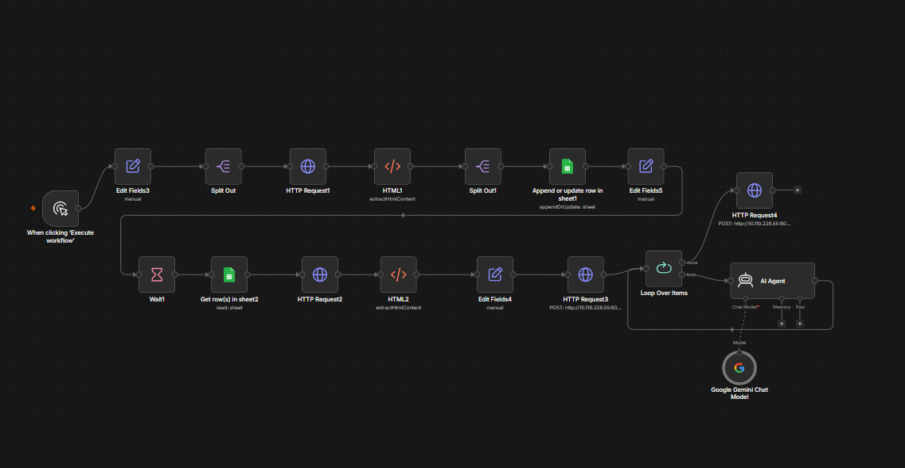

# Legal Document Processing for RAG

A workflow for extracting, cleaning, structuring, and preparing statutory and case law documents as Markdown for retrieval-augmented generation (RAG).

## Overview

This project documents a workflow developed for preparing legal texts for ingestion into a vector store.

It focuses on two categories of legal documents: statutes and court judgments. Documents are obtained from scanned PDFs or web-based sources, extracted, and subsequently processed into clean, structured Markdown.

The workflow combines document extraction tools, automation, visual editing, regular expressions, and Python scripts. Particular attention is given to preserving the structure and meaning of legal texts while correcting formatting inconsistencies that may arise during extraction.

## Document Extraction

Two extraction routes were used, depending on the source format.

### 1. Scanned PDF Documents

[LlamaParse](https://www.llamaindex.ai/llamaparse) is used to extract text from scanned legal documents. The service is primarily accessed through its cloud interface, although local execution is also possible.

The extracted text provides the starting point for subsequent cleaning, structural correction, and Markdown formatting.

### 2. Web-Based Content

An n8n workflow is used to retrieve court judgments published on websites.

The process involves:

1. Extracting judgment links from relevant webpages.
2. Recording the collected links in Google Sheets.
3. Retrieving individual links for processing.
4. Extracting the judgment text from each webpage.
5. Applying preliminary text cleanup through n8n Edit Fields nodes.
6. Sending the extracted text to a local Python HTTP server, which writes the content to the designated folder on the PC.

The workflow also includes an AI Agent node powered by Google Gemini to generate judgment summaries. These summaries are saved separately from the original judgment texts.

### Web Ingestion Workflow




## Local File Receiver

A lightweight Python HTTP server is used to receive extracted judgment text from n8n and save it directly to a local Windows directory.

The receiver accepts POST requests containing a JSON payload with two fields:

- `filename`: The name of the output file.
- `text`: The extracted document content.

Files are written using UTF-8 encoding. The receiving directory, server address, port, request-size limit, and authentication token can be configured through environment variables.

### Configuration

The following environment variables are supported:

| Variable | Purpose |
|---|---|
| `SAVE_DIRECTORY` | Local directory for saving received files |
| `FILE_RECEIVER_HOST` | Network interface on which the server listens |
| `FILE_RECEIVER_PORT` | Server listening port |
| `FILE_RECEIVER_TOKEN` | Bearer authentication token |
| `MAX_REQUEST_BYTES` | Maximum permitted request size |

### Running the Server

The script uses Python's standard library and requires no external package installation.

Configure the environment variables and start the server:

```powershell
$env:SAVE_DIRECTORY = "C:\path\to\output"
$env:FILE_RECEIVER_HOST = "0.0.0.0"
$env:FILE_RECEIVER_PORT = "8000"
$env:FILE_RECEIVER_TOKEN = "replace-with-a-long-random-secret"

python scripts/local_file_receiver.py
```

The n8n HTTP Request node sends the extracted text as JSON and supplies the corresponding bearer token in its Authorization header.

The receiving server validates the request and filename before writing the document to the designated directory.

The server should only be accessible through a trusted network or appropriately secured connection. Authentication does not replace transport encryption.

## Text Preprocessing and Markdown Structuring

Successful text extraction does not necessarily produce content that is immediately suitable for RAG.

Extracted legal documents frequently contain formatting inconsistencies, misplaced line breaks, irregular spacing, and structural problems. These issues require further processing.

Documents are handled individually using Notepad++.

The preprocessing stage involves:

- Organising headings and subheadings into an appropriate hierarchy.
- Applying consistent indentation.
- Structuring block quotes, tables, and horizontal rules where appropriate.
- Correcting misplaced or inconsistent punctuation.
- Removing unnecessary spaces and line breaks.
- Preserving the organisation and logical structure of the original legal text.

The objective is to produce consistently structured Markdown while retaining the substantive content of the source document.

## Regular Expression-Based Quality Checks

Regular expressions are used extensively in Notepad++ to identify and correct recurring formatting problems.

These checks include:

- Missing or wrongly placed punctuation.
- Double spaces and other spacing inconsistencies.
- Multiple consecutive line breaks.
- Unwanted characters and formatting artefacts.
- Other textual irregularities arising from extraction.

These operations help standardise documents and reduce inconsistencies before they are prepared for downstream processing.

## Python-Based Paragraph Anchoring

A custom Python script is used to affix sequential paragraph numbers in square brackets, such as `[1]`, `[2]`, and `[3]`.

These paragraph identifiers serve as anchors within the document, making individual text passages easier to reference and identify during subsequent retrieval.

## File Naming and Organisation

A consistent file-naming convention is used to organise the processed legal documents.

Original extracted texts, processed Markdown documents, and AI-generated judgment summaries are maintained in their respective locations to distinguish source material from derived content.

## Tools and Technologies

| Tool | Application |
|---|---|
| LlamaParse | Text extraction from scanned PDFs |
| n8n | Web content extraction and workflow automation |
| Google Sheets | Collection and tracking of judgment links |
| Notepad++ | Manual text preprocessing and Markdown structuring |
| Regular Expressions | Text cleanup and formatting checks |
| Python | Local file handling and paragraph anchoring |
| Google Gemini | AI-assisted judgment summarisation |

## Quality and Processing Approach

The processing workflow is deliberately detailed and involves both automated operations and manual review.

Rather than treating extracted text as a finished product, each document undergoes further inspection and refinement.

The emphasis is on:

- Textual accuracy and consistency.
- Preservation of legal document structure.
- Appropriate Markdown formatting.
- Reliable paragraph identification.
- Removal of extraction-related artefacts.
- Preparation of clean text suitable for vector store ingestion.

The resulting Markdown documents are intended to provide a consistent textual foundation for retrieval-augmented generation applications.

## Project Scope

This repository focuses on the technical processes, tools, and methods involved in preparing statutory and case-law documents for RAG.

It does not reproduce confidential source materials or identify private document collections. Supporting scripts and workflow documentation may be included in sanitised form to demonstrate the processing methods.

---

**Note:** The quality of a RAG system depends not only on its retrieval architecture but also on the quality, structure, and consistency of the documents supplied to it.
